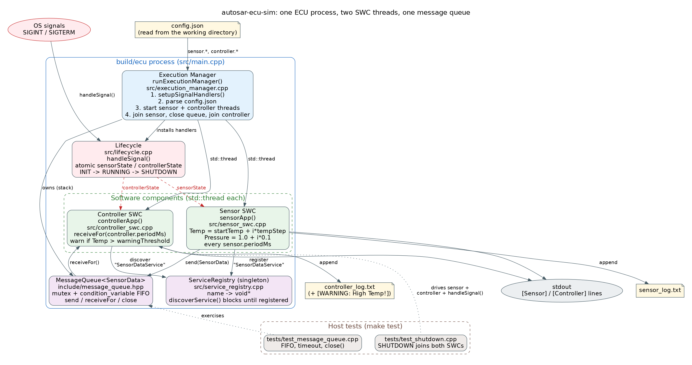

# Adaptive AUTOSAR ECU Simulation (C++)

This project simulates an Adaptive AUTOSAR-style ECU using open-source C++ on Linux/macOS. It progressively evolves from Classic AUTOSAR concepts into Adaptive architecture — all without needing any hardware or licensed tools.

---

## 🚗 Features Implemented

- **Sensor & Controller SWCs** running in parallel POSIX threads
- **ExecutionManager** that launches the apps and shuts them down in order
- **JSON configuration** (instead of ARXML) for runtime control
- **Config-driven timing** and behavior
- **Logging** of sensor data and controller decisions to stdout, `sensor_log.txt` and `controller_log.txt`
- **Message queue IPC**: a thread-safe `MessageQueue<SensorData>` (replaced the earlier shared memory)
- **Service discovery**: a `ServiceRegistry` singleton the controller uses to find the sensor's queue
- **Lifecycle states** (`INIT`, `RUNNING`, `SHUTDOWN`) with graceful shutdown on `SIGINT`/`SIGTERM`
- **Host tests** for the message queue and the shutdown path

---

## 🏗 Architecture

See [docs/architecture.md](docs/architecture.md) for the components, runtime flow and configuration.



The diagram is generated from [docs/diagrams/architecture.dot](docs/diagrams/architecture.dot) with `docs/diagrams/render.sh` (needs Graphviz).

---

## 📁 Project Structure

```
autosar-ecu-sim/
├── include/
│   ├── controller_swc.hpp
│   ├── execution_manager.hpp
│   ├── lifecycle.hpp
│   ├── message_queue.hpp      # header-only MessageQueue<T>
│   ├── sensor_swc.hpp
│   ├── sensor_types.hpp       # SensorData
│   ├── service_registry.hpp
│   └── nlohmann/              # vendored nlohmann/json
├── src/
│   ├── main.cpp
│   ├── controller_swc.cpp
│   ├── execution_manager.cpp
│   ├── lifecycle.cpp
│   ├── sensor_swc.cpp
│   └── service_registry.cpp
├── tests/
│   ├── test_message_queue.cpp
│   └── test_shutdown.cpp
├── docs/
│   ├── architecture.md
│   └── diagrams/              # architecture.dot, .png, .svg, render.sh
├── config.json
├── Makefile
└── README.md
```

---

## 🧩 Next Steps (Planned)

- Simulate **platform deployment**

---

## 🛠 Build & Run

```bash
make clean && make
./build/ecu          # run from the repo root so config.json is found; Ctrl+C to stop
make test            # host tests
```
