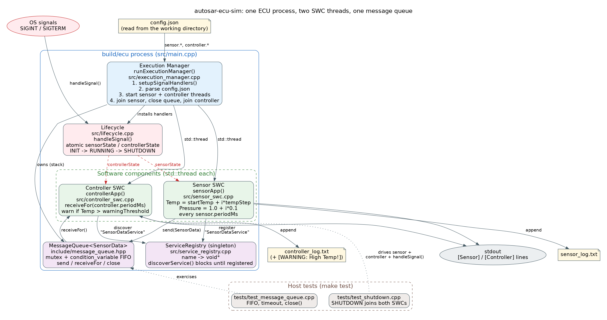

# Architecture

This page describes the ECU simulation as it is on `main`: one process (`build/ecu`) that runs two software components (SWCs) on POSIX threads and passes sensor data between them through a thread-safe message queue.

The diagram source is [`diagrams/architecture.dot`](diagrams/architecture.dot) (Graphviz). After editing it, run `docs/diagrams/render.sh` to regenerate [`architecture.png`](diagrams/architecture.png) and [`architecture.svg`](diagrams/architecture.svg). The script needs Graphviz (`sudo apt-get install graphviz` or `brew install graphviz`).

## Components

| Component | Files | Role |
|---|---|---|
| Entry point | `src/main.cpp` | Calls `runExecutionManager()` and returns 0. |
| Execution Manager | `include/execution_manager.hpp`, `src/execution_manager.cpp` | Installs signal handlers, reads `config.json`, creates the `MessageQueue<SensorData>`, starts the sensor and controller threads, and shuts them down in order. |
| Lifecycle | `include/lifecycle.hpp`, `src/lifecycle.cpp` | `AppState` (`INIT`, `RUNNING`, `SHUTDOWN`), the atomics `sensorState` and `controllerState`, and the `SIGINT`/`SIGTERM` handler that sets both to `SHUTDOWN`. |
| Sensor SWC | `include/sensor_swc.hpp`, `src/sensor_swc.cpp` | `sensorApp()`: registers the queue as `SensorDataService`, then every `sensor.periodMs` sends a `SensorData` sample and logs it. |
| Controller SWC | `include/controller_swc.hpp`, `src/controller_swc.cpp` | `controllerApp()`: discovers `SensorDataService`, waits up to `controller.periodMs` for a sample, and logs it with a warning when the temperature is above `controller.warningThreshold`. |
| Message queue | `include/message_queue.hpp` | Header-only `MessageQueue<T>`: a FIFO guarded by a mutex and condition variable, with `send`, `receive`, `receiveFor(timeout)`, `close`, `closed` and `size`. |
| Service registry | `include/service_registry.hpp`, `src/service_registry.cpp` | Process-wide singleton mapping a service name to a `void*`. `discoverService()` blocks until the name is registered. |
| Data type | `include/sensor_types.hpp` | `SensorData { float temperature; float pressure; }`. |
| JSON parser | `include/nlohmann/` | Vendored [nlohmann/json](https://github.com/nlohmann/json), used only by the Execution Manager. |

## Runtime flow

1. `main()` calls `runExecutionManager()`.
2. The Execution Manager installs `handleSignal` for `SIGINT` and `SIGTERM`.
3. It opens `config.json` from the current working directory and reads `sensor.startTemp`, `sensor.tempStep`, `sensor.periodMs`, `controller.warningThreshold` and `controller.periodMs`. If the file is missing it prints `Failed to open config.json` and returns.
4. It creates a `MessageQueue<SensorData>` on its stack and starts two `std::thread`s: `sensorApp(queue, ...)` and `controllerApp(...)`.
5. The sensor sets `sensorState = RUNNING` and registers the queue under `SensorDataService`. On each cycle it computes sample *i* as temperature `startTemp + i * tempStep` and pressure `1.0 + i * 0.1`, calls `queue.send()`, prints `[Sensor] ...` to stdout, appends to `sensor_log.txt`, and sleeps `sensor.periodMs`.
6. The controller sets `controllerState = RUNNING` and calls `discoverService("SensorDataService")`, which blocks until the sensor has registered the queue. On each cycle it calls `receiveFor(controller.periodMs)`. When a sample arrives and its temperature differs from the previous one, it prints `[Controller] ...` and appends to `controller_log.txt`, adding `[WARNING: High Temp!]` above the threshold. It then sleeps `controller.periodMs`.
7. On `SIGINT`/`SIGTERM`, `handleSignal` stores `SHUTDOWN` in both state atomics (async-signal-safe: no I/O). Each SWC leaves its loop at its next check. Once in its loop, the controller never blocks for longer than `controller.periodMs`, because it uses `receiveFor` instead of the unbounded `receive`. Each SWC stores `RUNNING` in its state when its thread starts, so a signal that arrives before that store is overwritten and the simulation keeps running. Send the signal again to stop it.
8. The Execution Manager joins the sensor thread, calls `queue.close()` to wake any blocked receiver, joins the controller thread, and prints `[Execution Manager] All apps have shut down.`

## Configuration

`config.json` (repository root). Every key is required: the Execution Manager reads them with no fallback, so a missing or mistyped key throws an uncaught `nlohmann::json` exception. The values below are the shipped settings.

| Key | Shipped value | Meaning |
|---|---|---|
| `sensor.startTemp` | `20.0` | Temperature of the first sample. |
| `sensor.tempStep` | `1.0` | Temperature increase per sample. |
| `sensor.periodMs` | `1000` | Sensor cycle time. |
| `controller.warningThreshold` | `25.0` | Temperature above which the controller logs a warning. |
| `controller.periodMs` | `2000` | Controller receive timeout and sleep per cycle. |

## Outputs

- stdout: `[Sensor]` and `[Controller]` lines, then shutdown messages.
- `sensor_log.txt` and `controller_log.txt`, appended in the working directory on every run. `make clean` deletes them, and `.gitignore` ignores `*.txt`.

## Build and tests

The `Makefile` compiles with `g++ -std=c++17 -pthread -Wall -Wextra`; there is no CMake and no CI workflow.

| Target | Output | What it does |
|---|---|---|
| `make` | `build/ecu` | Builds the simulator from `src/main.cpp` and the five component sources. |
| `make test` | `build/test_message_queue`, `build/test_shutdown` | Builds and runs both host tests. |
| `make clean` | | Removes the binaries and the two log files. |

- `tests/test_message_queue.cpp` checks FIFO order, `size`, `receiveFor` timeouts, and `close()` semantics (wakes receivers, drops later sends, keeps pending messages readable).
- `tests/test_shutdown.cpp` starts a slow sensor (3000 ms) and a fast controller (20 ms), calls `handleSignal(SIGINT)`, and checks that both threads join within 10 s. It is the regression test for the controller shutdown hang fixed in PR #3.
